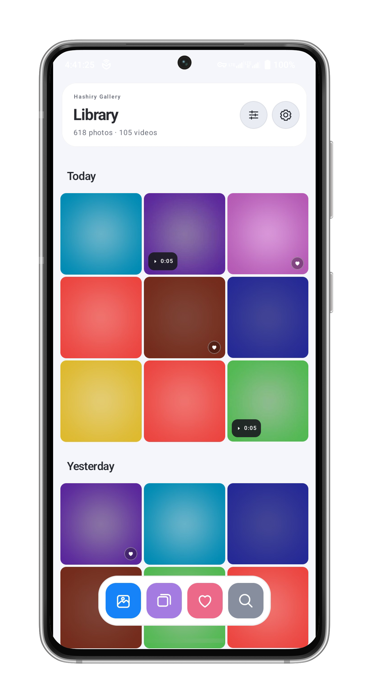
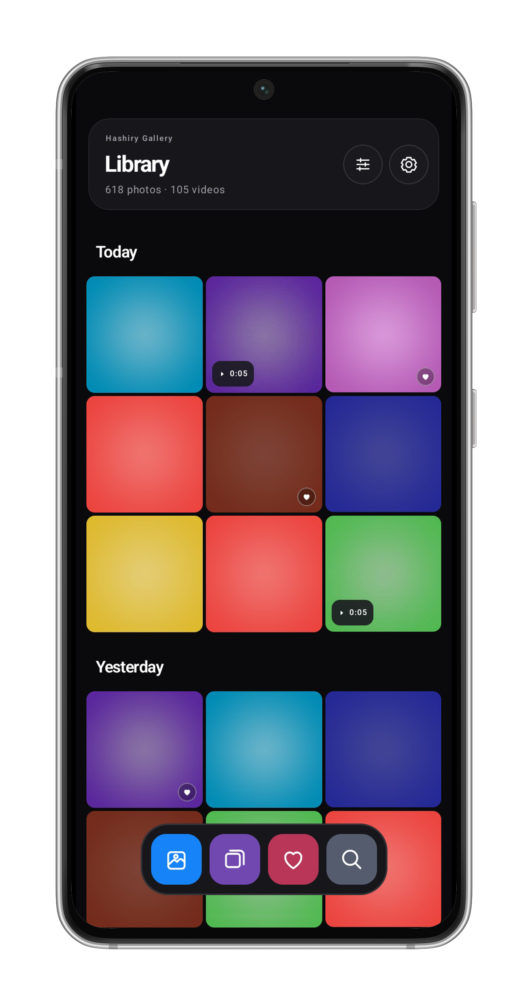
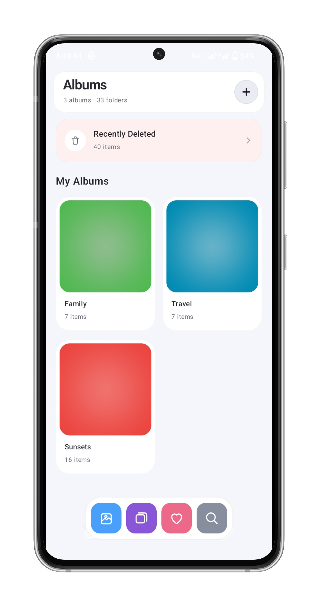
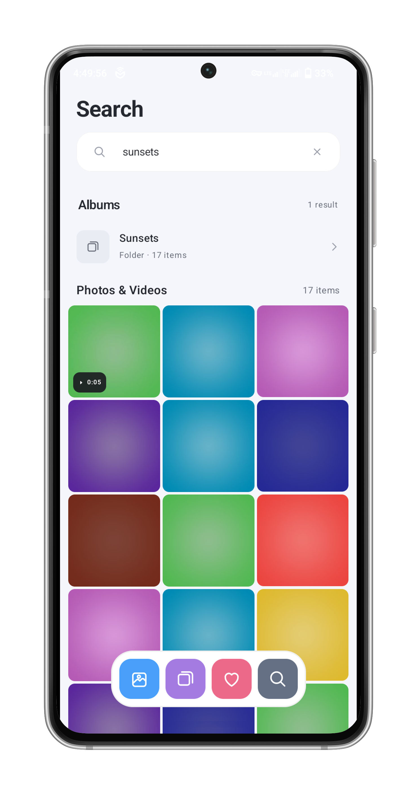
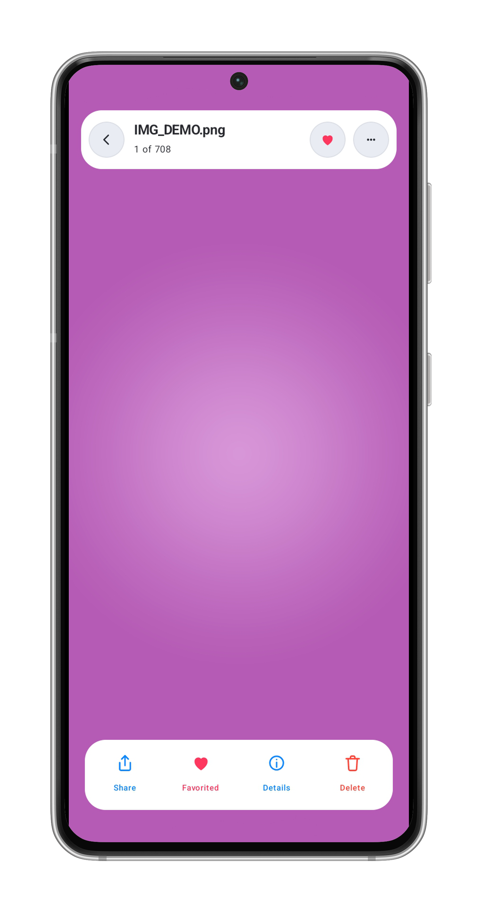
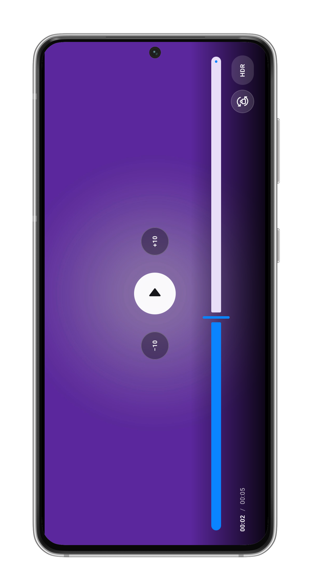

# Hashiry Gallery

A local-first Android gallery for your photos, videos, albums, and more with a clean and customizable interface, powerful media browsing, and convenient tools to manage your collection.

  <a href="https://github.com/hashierholmes/Hashiry-Gallery/releases/latest"><strong>⬇ Download latest release</strong></a>
  · <a href="https://github.com/hashierholmes/Hashiry-Gallery/issues">Report a bug</a>
  · <a href="https://github.com/hashierholmes/Hashiry-Gallery/issues">Request a feature</a>

## Screenshots

| Library (Light) | Library (Dark) | Albums |
| --- | --- | --- |
|  |  |  |

| Search | Photo Viewer | Video Player |
| --- | --- | --- |
|  |  |  |

## Features

- **Media library** — Browse photos and videos in a date-grouped grid, explore device folders, search your collection, and manage Favorites with batch selection.
- **Albums and folders** — Browse media organized into albums and folders discovered on your device.
- **Recently Deleted** — Restore deleted items or permanently remove individual or multiple items.
- **Photo viewer** — View images with swipe navigation, pinch-to-zoom, and panning.
- **Video player** — Media3-powered playback with timeline scrubbing, ±10-second seeking, orientation locking, and Smart Enhance.
- **WebP support** — Discover, display, and view WebP images directly in the gallery.
- **PSD support** — Discover and preview supported Photoshop files throughout the library, viewer, Favorites, and Recently Deleted.
- **External viewer integration** — Open unsupported media using compatible apps through Android's app chooser.
- **Thumbnail caching** — Memory LRU and persistent disk caching, MediaStore thumbnail loading, and bounded background processing to help manage large media libraries.
- **Media management** — Optional Android special access with standard permission fallbacks.
- **File management** — Optional Android All files access integration for broader file operations, including managing supported files that cannot be handled through standard media permissions.
- **Appearance and settings** — Customize display preferences and access privacy information, app details, and developer links.
- **Local-first by design** — No Internet permission declared in the app manifest.

### PSD compatibility

Hashiry supports previews of flattened 8-bit RGB and grayscale composites using supported raw, PackBits/RLE, ZIP, and ZIP-prediction compression.

Layer editing is not supported. CMYK, 16-bit, 32-bit, PSB, and unsupported composites may fail to preview.

## Download

  <strong>Android 7.0+</strong> · Free and open source

Tap the download button to download the latest version of Hashiry directly to your Android device. No need to navigate through GitHub Releases.

If the download doesn't start, [visit the Releases page](https://github.com/hashierholmes/Hashiry-Gallery/releases/latest) to check available versions and downloads.

### Installation

1. Download the APK using the button above.
2. Open the downloaded APK on your Android device.
3. If prompted, allow your browser or file manager to install unknown apps.
4. Tap **Install** and open Hashiry Gallery.

## Requirements

- **Android:** 7.0 (API 24) or newer
- **Android Studio:** Android SDK 36 and JDK 17
- **Code On The Go (CoGo):** A project setup with the Android SDK/build tools and Java 17 available
- **First build:** Internet access to download the Gradle distribution and dependencies

## Build

### Android Studio

Open the project in Android Studio, sync Gradle, and build the `app` debug variant.

### Code On The Go (CoGo)

Open the project folder in CoGo and run `:app:assembleDebug` using the Gradle task runner or terminal.

The debug APK is generated at:

`app/build/outputs/apk/debug/app-debug.apk`

### Release signing

To configure release signing, use `release.properties.example` as a template and provide your own keystore details:

- `storePassword` — Keystore password
- `keyAlias` — Signing key alias
- `keyPassword` — Signing key password
- `storeFile` — Path to your keystore file

Replace the example values with your actual signing credentials and configure the keystore path to match your setup.

## Tech Stack

- Kotlin
- Jetpack Compose and Material 3
- AndroidX
- Coil 2.7.0
- AndroidX Media3 1.4.1
- Gradle Kotlin DSL

## Acknowledgments

Hashiry builds on the [iOS Gallery project](https://github.com/technicalnihilist-lgtm/ios-gallery), adapted for Android with its own implementation, design, and additional features.

Thanks to the original project author and the developers behind the libraries that make Hashiry possible. Their respective licenses and notices apply.

## License

Hashiry is released under the [MIT License](LICENSE), subject to the applicable licenses and permissions of upstream-derived code and third-party components.

---

**Made with 🩷 for Android.**

[⬆ Back to top](#hashiry-gallery)

